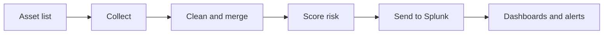

# External Exposure Monitor

Passive external exposure monitoring for known internet-facing assets, with Splunk integration.

**Live overview:** https://areimanth.github.io/EASM/

---

## Overview

External Exposure Monitor is a lightweight security tool for SOC teams. It checks your known public assets against passive OSINT sources, normalizes and scores what it finds, and forwards the results to Splunk for dashboards, alerting and analysis.

It answers one question on a schedule: **what can someone on the internet see on our assets right now, and what changed?**

Nothing is sent to your assets. The tool reads what internet-wide scanners have already indexed.

---

## What is EASM?

External Attack Surface Management (EASM) is the practice of continuously finding and tracking the systems an organization exposes to the internet: open ports, running services, certificates, and known vulnerabilities. Attackers look at this surface first, so defenders need the same view.

This project covers the monitoring side of EASM for assets you already know about (single IPs, CIDR ranges, or an organization name).

| | Active scanning | Passive monitoring (this project) |
|---|---|---|
| How | Probes your hosts directly | Reads data from public scan indexes |
| Traffic to your assets | Yes | None |
| Data freshness | Current | As recent as the source's last scan |
| Approval needed | Often | No |

---

## How the pipeline works



1. **Load targets.** Read your asset list: IPs, CIDR ranges, or organization names. CIDR ranges are expanded to single IPs.
2. **Collect.** Query every configured data source for every IP. If one source fails, the error is logged and the others continue.
3. **Clean and merge.** Combine duplicate findings from different sources into one, and mark IPs with nothing exposed as clean.
4. **Score risk.** Rank each finding against an editable severity rule set.
5. **Send to Splunk.** Deliver the scored findings as events through the Splunk HTTP Event Collector (HEC). A failed send is logged and does not stop the run.
6. **Analyze.** Use Splunk dashboards and alerts to see the current surface and to catch new or changed exposure.

---

## Data sources

| Source | What it provides | Requirement |
|---|---|---|
| InternetDB | Open ports, hostnames, tags, known CVEs per IP | None, always on |
| Censys | Internet-wide scan data for hosts and services | API key |
| Netlas | Internet-wide scan data, services and certificates | API key |
| LeakIX | Exposed services and leaks | API key |
| Shodan | Asset intelligence, and the only source used for organization-wide queries | Paid API key |

A source without credentials is skipped, so the tool still runs with the free source alone. Organization targets run only when Shodan is configured.

---

## CTEM and this pipeline

Continuous Threat Exposure Management (CTEM) is a five-stage cycle, introduced by Gartner, for reducing exposure over time rather than reacting to one-off scans. The pipeline supports it as follows.

| CTEM stage | Purpose | In this project |
|---|---|---|
| **Scoping** | Decide which assets matter | Your asset list defines the scope |
| **Discovery** | Find what is exposed | Passive sources report ports, services and CVEs for each in-scope IP |
| **Prioritization** | Fix the most important things first | The risk engine scores findings with editable severity rules |
| **Validation** | Confirm an exposure is real and reachable | Partial. Passive data can be stale, so an analyst confirms in Splunk |
| **Mobilization** | Get the fix done | Splunk alerts and dashboards route findings to the SOC |

The first three stages are covered by the pipeline. Validation and Mobilization rely on analyst action and on how your team uses the Splunk output.

---

## Features

- Passive external exposure monitoring
- Multiple intelligence sources: InternetDB, Censys, Netlas, LeakIX, Shodan
- Asset inventory support for IPs, CIDR ranges and organizations
- Event normalization and de-duplication
- Risk scoring from editable rules
- Exposure change detection
- Splunk HTTP Event Collector integration
- Dashboards and alerts

---

## Quick start

1. Install dependencies:
   ```bash
   pip install -r requirements.txt
   ```
2. List your targets in `assets.yaml`.
3. Add your Splunk HEC details and any API keys to `.env`. Do not commit real secrets.
4. Run the collector:
   ```bash
   python main.py
   ```
5. Search the results in Splunk and build your dashboards and alerts.

Run it on a schedule (for example with cron on an EC2 instance, or in a container) to keep the picture current.

---

## Integrations

| Destination | Status |
|---|---|
| Splunk (HEC) | Connected |
| Microsoft Sentinel | Can be integrated |
| Wazuh | Can be integrated |
| ELK | Can be integrated |

Delivery targets are separate from collection, so adding a destination does not change the sources or scoring.

---

## Technology stack

Python, Splunk Enterprise, Shodan, Censys, Netlas, LeakIX, InternetDB, Docker, AWS EC2

---

## Project status

Under active development.

---

##Contributors

<table>
  <tr>
    <td align="center">
      <a href="https://github.com/AreImanth">
        <br>
        <b>Are Imanth</b>
      </a>
    </td>
    <td align="center">
      <a href="https://github.com/venkatvellapalem">
        <br>
        <b>Venkat Vellapalem</b>
      </a>
    </td>
  </tr>
</table>

---

## License

This project is licensed under the MIT License.
